Ran list files in prototype folder
Analyzed README-MOD-Pizza-Complete-Feature-Guide.md:L1-120
Analyzed index.html:L1-36
Ran inspect script sizes and line counts
Analyzed app.js:L1-50
Analyzed app.js:L51-150
Ran inspect headers of JS files
Ran list test files
Analyzed README-MOD-Pizza-Complete-Feature-Guide.md:L121-250
Ran inspect CSS stylesheets
Ran analyze functions in prototype JS files
Ran check where topping portions are implemented
Ran inspect key functions in consumer-refresh.js
Ran inspect customerHome() in journeys.js
Ran inspect more of customerHome()
Ran list images in assets
Ran inspect menuImage implementation

# 360° Comprehensive Architectural, UI/UX & Functional Review
**Target Artifact:** MOD Pizza Web Application & Operations Prototype  
**Scope:** Complete Codebase & Workflows (`index.html`, `app.js`, `consumer-refresh.js`, `journeys.js`, `operations.js`, `catalog.js`, `loyalty.js`, `groups.js`, `workspaces.js`, `ordering-ui.js`, `styles.css`, `app-experience.css`, `consumer-refresh.css`, `white-design.css`)  
*(All audit-related files have been strictly excluded per directive)*

---

## Executive Appraisal

This prototype is already **an extraordinary technical and conceptual achievement**. Building a client-side multi-sided platform—encompassing a consumer storefront, a 6-store Kitchen Display System (KDS) manager, an enterprise HQ authoring console, and a stakeholder roadmap—entirely in vanilla HTML, CSS, and JavaScript with **zero build step and zero backend dependencies** is exceptional.

However, to elevate this from a *clever demonstration prototype* into **the undisputed benchmark for quick-service restaurant (QSR) web applications worldwide** (competing with and outperforming Domino's, Chipotle, Sweetgreen, Starbucks, and CAVA), several architectural bottlenecks, visual disparities, and workflow gaps must be bridged.

Here is the exhaustive 360° review across all dimensions, followed by the definitive blueprint to make it the best in the world.

---

## 1. UI & Visual Design (Aesthetics, Visual Hierarchy & Branding)

### Strengths
* **Clean, Modern Whitespace:** The recent white design refresh (`white-design.css`) strips out muddy cream backgrounds, giving food cards and primary actions the spotlight.
* **Distinct Surface Accents:** MOD Red (`#c4122f`) and deep wine (`#8b0f05`) are applied consistently to primary call-to-actions, badges, and active states.
* **True Responsive Shell:** Adapts gracefully from 320px mobile viewports up to 1440px desktop screens with dedicated mobile bottom tabs and desktop sidebar summaries.

### Areas for Improvement & Gaps
1. **The "7 vs. 39" Food Photography Disparity:**
   * In `assets/`, there are high-resolution photos for only 7 core items (`pepperoni`, `custom`, `margherita`, `firebird`, `veggie`, `salad`, `cake`).
   * The remaining **39 menu items** in `catalog.js` fall back to a generic monochrome SVG icon (`assets/menu-pizzas.svg`, `assets/menu-salads.svg`).
   * *Impact:* When browsing pizzas like *Spicy Thai*, *Lucy Sunshine*, or *Calexico*, users see flat vector icons instead of mouthwatering food imagery. In food e-commerce, appetite appeal drives conversion; generic icons feel like an enterprise database rather than a restaurant.
2. **CSS Specificity Wars & Cascading Clutter:**
   * Four separate stylesheets are linked in `index.html`: `styles.css` $\rightarrow$ `app-experience.css` $\rightarrow$ `consumer-refresh.css` $\rightarrow$ `white-design.css`.
   * `consumer-refresh.css` introduces warm paper tokens (`--bg: #faf7f0;` and radial gradients), which are then immediately overridden by `white-design.css` (`--bg: #fff;`).
   * Dead CSS rules, redundant selectors, and conflicting variable overrides bloat the style pipeline and make brand theming difficult to maintain.
3. **Brand Identity & "MOD Punk Rock" Character:**
   * MOD Pizza's brand DNA is defined by irreverence, music, energy, bold typography, and a "people-first" ethos.
   * The current UI is somewhat clinical and corporate. The stamp badge (`<span class="hero-stamp">`) is a great start, but the app lacks tactile character—textured kraft accents, sticker-style badges, dynamic micro-copy, and playful illustrations.
4. **Desktop Information Density on Menu Pages:**
   * On wide viewports (1200px+), the three-column layout (Categories $\rightarrow$ Food Grid $\rightarrow$ Sidebar Bag) leaves substantial awkward negative space between the search bar and the category pills. The mini-bag card floats statically and feels disconnected from the ordering flow.

---

## 2. UX & Micro-Interactions (Friction, Feedback & Delight)

### Strengths
* **Non-destructive Store Switching:** Changing stores recalculates pricing and tax while preserving the customer’s bag items and customizations.
* **Persistent Audiences:** Seamless toggling between Guest and Member modes with isolated profiles, order histories, and wallet balances.
* **Clear Empty States:** Thoughtful messaging and direct routing back to the menu when cart or orders are empty.

### Critical UX Bottlenecks & Gaps
1. **The "innerHTML Destroy-and-Rebuild" Re-render Anti-Pattern:**
   * In `app.js`, nearly every user action ends with `save(); render();`, which runs:
     ```javascript
     app.innerHTML = header() + audienceBar() + `<main id="main">${content}${footer()}</main>` + nav();
     ```
   * *The Problem:* Tearing down and replacing the entire root DOM on every state change destroys ongoing CSS transitions, resets scroll positions, and drops keyboard focus. Typing in a search field or toggling a filter causes micro-flickers.
   * *The Fix:* Move to targeted DOM patching or fine-grained container rendering (e.g., updating only `#checkout-totals` or `#products-grid` instead of the entire page).
2. **The "Form Inside a Modal" Pizza Customizer:**
   * Pizza customization is currently housed inside a native `<dialog id="modal">` containing standard radio buttons and checkboxes.
   * This is the single biggest missed opportunity in the app:
     * There is **no visual pizza canvas** showing dough, sauce spreading, or toppings dropping onto the pizza as you select them.
     * It feels like filling out an administrative survey rather than crafting an artisan pizza.
3. **The "Portion Customization Disconnect":**
   * When building a pizza initially, users can only check or uncheck toppings (binary yes/no).
   * Yet, *after* the order is placed, `toppingStatus(o)` in `consumer-refresh.js` suddenly reveals portion controls (*Light*, *Regular*, *Extra*) on the tracking screen!
   * *User Frustration:* Why can't a customer ask for "Extra Mozzarella", "Light Tomato Sauce", or "Sauce on the Side" while building the pizza upfront?
4. **Mobile Dialogs vs. Native Bottom Sheets:**
   * On mobile screens, modal dialogs center awkwardly with desktop-style scrollbars. In modern mobile UX, mobile modals must render as draggable **Bottom Sheets** with smooth touch-drag dismiss gestures.

---

## 3. Feature Completeness & Competitive Benchmarking

Let's benchmark the prototype against the world's best food ordering platforms:

| Feature Dimension | Current Prototype State | Industry Best-in-Class (Domino's / Sweetgreen / Chipotle) | Gap to "Best in the World" |
|---|---|---|---|
| **Pizza Builder** | Modal with text radio/checkbox lists. Fixed single-pizza build. | 3D / Layered visual canvas; Left Half / Right Half toppings; portion sliders; crust bake levels (Well Done / Normal); post-bake sauce drizzles. | **Major Gap:** Needs visual topping layering, half-and-half splits, and post-bake finishing sauces. |
| **Dietary Intelligence** | Filter chips (All, Veg, Non-veg, Vegan). | Multi-select matrix (Gluten-Sensitive, Dairy-Free, Nut-Free, Keto, Halal) + automated conflict warnings when an incompatible topping is picked. | **Moderate Gap:** Expand single-select chips into a robust dietary profile engine with allergen conflict alerts. |
| **Smart Cart & Upsell** | Static 3 add-on cards in Cart (`cartExtras`). | Contextual AI upsell: identifies missing drink/sides, offers bundle completion discounts ("Add a drink for $1.50 to make it a combo"). | **Moderate Gap:** Implement bundle auto-detection and dynamic discount prompts. |
| **Tipping Engine** | Fixed dollar buttons: `$0, $2, $3, $5`. | Percentage chips (`15%, 18%, 20%, 25%`) + Custom Tip modal. | **High Friction on Large Orders:** A $3 tip on a $100 group order is inadequate; needs dynamic percentage calculation. |
| **Group Ordering** | Host-paid simulation with local avatar switching. | Real-time multi-device synchronization via link/QR; individual payment splitting; live guest arrival badges; spending limits per guest. | **High Innovation Opportunity:** Add real-time multi-tab `BroadcastChannel` synchronization. |
| **Order Tracking** | Pre-rendered vector map of Seattle streets with simulated timer. | Dynamic store-to-customer route based on active store (Austin, Denver, Phoenix, etc.); live interactive courier step simulation. | **Moderate Gap:** Adapt map visual to selected store city; add interactive delivery driver messaging. |
| **Kitchen KDS** | Static stage columns with manual advance buttons. | Audio order chime; SLA target timers (Green $\rightarrow$ Yellow $\rightarrow$ Flashing Red for delayed tickets); split make-line / expo screens. | **High Value for Operations:** Add audio chimes and overdue ticket alerts. |
| **HQ Analytics** | Text tables and CSV download. | Interactive canvas chart widgets (Revenue trends, Product Mix, Peak Hour Heatmaps, Store Leaderboards). | **High Executive Polish Gap:** Visual dashboard charts will dramatically elevate stakeholder demonstrations. |

---

## 4. End-to-End User Flow & Workflow Review

### Flow 1: First-Time Guest Fast-Order Flow
* **Current State:** A guest arrives, toggles between Delivery/Pickup, picks an item, fills out name, email, phone, allergy notes, address, chooses demo payment, and places the order.
* **Friction Points:**
  * Delivery address input has no auto-suggestion or validation; typos are saved silently.
  * Toggling Pickup vs. Delivery changes prices and minimums, but does not visually highlight the financial delta in the order button until the user scrolls down to totals.
* **Suggestion:** Implement a 3-step rapid checkout stepper (`1. Where & When` $\rightarrow$ `2. Your Details` $\rightarrow$ `3. Payment`) with automatic address auto-complete simulation.

### Flow 2: The Pizza Customization Journey ("Create Your Own")
* **Current State:** User clicks "Build my pizza" $\rightarrow$ Modal opens $\rightarrow$ Select Size $\rightarrow$ Select Crust $\rightarrow$ Select Sauce $\rightarrow$ Check Toppings $\rightarrow$ "Add to bag".
* **Friction Points:**
  * No visual representation of the pizza.
  * No Half-and-Half selector (e.g., Mom wants mushrooms on the left, kids want pepperoni on the right).
  * No finishing drizzles (Mike's Hot Honey, Balsamic Glaze, BBQ Drizzle).
  * Calories display is static (`Custom calories`), failing to calculate nutrition dynamically as heavy meats or extra cheeses are added.
* **Suggestion:** Replace the modal with an interactive, full-screen **Visual Pizza Lab** (detailed in Section 6).

### Flow 3: Group Order Coordination
* **Current State:** Host creates group $\rightarrow$ Sets budget and deadline $\rightarrow$ Switches between sample avatars (Host, Sam, Jordan, Taylor) on the same machine $\rightarrow$ Locks group $\rightarrow$ Checks out.
* **Friction Points:**
  * Having to switch participants on the same screen breaks the illusion of a collaborative group order.
* **Suggestion:** Utilize the browser's native `BroadcastChannel` API! When the host starts a group order, generate a link with `#group/join/[id]`. If opened in a second tab or private window, the second tab acts as "Taylor", and items added in Tab 2 appear **in real time** on the Host's screen in Tab 1!

### Flow 4: Post-Order Status & Live Topping Amendment
* **Current State:** Once placed, order appears in `#track/[id]`. A courier bike moves along a line. Users can edit toppings before preparation starts.
* **Friction Points:**
  * The map always says "Pine Street, 3rd Avenue" (Seattle), even if the customer selected the Austin, Denver, or Phoenix location!
  * Editing toppings increments an invoice revision number, but there is no visual comparison showing what was removed vs. what was added.
* **Suggestion:** Dynamically render street names corresponding to the active store's city, and display a clear "Before & After" topping modification diff.

---

## 5. Technical Architecture & Code Health

### 1. Monolithic Global Namespace Pollution
In `index.html`, 15 scripts are loaded sequentially:
```html
<script defer src="operations.js"></script>
<script defer src="experience.js"></script>
...
<script defer src="app.js"></script>
```
* Every variable (`state`, `ops`, `checkout`, `category`, `dietFilter`, `groupPerson`) is declared on the global `window` object.
* Any script can unpredictably overwrite another script's internal state.
* **Recommendation:** Gradually migrate to standard JavaScript ES Modules (`<script type="module" src="app.js">`) with explicit `import`/`export` boundaries.

### 2. LocalStorage Monolith & Performance Degradation
* The entire application state—including 46 menu items, 6 stores, all historical orders, active audit logs, support tickets, campaigns, and group orders—is serialized into a single `localStorage` key (`mod-pizza-prototype-v1`).
* Every click triggers `JSON.stringify(state)`. As orders and logs accumulate, this synchronous serialization can cause frame drops and lag on mobile devices.
* **Recommendation:** Segment state into logical keys (`mod_cart`, `mod_orders`, `mod_settings`, `mod_operations`) or implement an in-memory reactive store that debounces disk writes.

---

## 6. The Blueprint: How to Make It the Best in the World

To transform this prototype into an industry-defining masterpiece, focus on these **5 Showstopper Innovations**:

```mermaid
flowchart TD
    subgraph S1["1. The Visual Pizza Lab"]
        P1["Layered SVG/Canvas Pizza Engine"] --> P2["Half & Half Split Visualizer"]
        P2 --> P3["Real-time Calorie & Price HUD"]
        P3 --> P4["Portion Toggles: Light / Normal / Extra"]
    end

    subgraph S2["2. Multi-Tab Real-Time Group Sync"]
        G1["BroadcastChannel API"] --> G2["Open Tab 1 (Host) + Tab 2 (Guest)"]
        G2 --> G3["Live Cross-Tab Cart Updates with zero backend"]
    end

    subgraph S3["3. Commercial KDS Experience"]
        K1["Audio Chime on Incoming Order"] --> K2["SLA Countdown Timers (Green -> Yellow -> Red)"]
        K2 --> K3["Interactive Bump Bar & Station Routing"]
    end

    subgraph S4["4. Interactive HQ Analytics"]
        A1["Canvas Trend Charts"] --> A2["Category Sales Mix Donuts"]
        A2 --> A3["Hourly Rush Heatmaps"]
    end

    subgraph S5["5. Mobile Bottom Sheet & Smart Upsells"]
        M1["Touch-draggable Bottom Sheets"] --> M2["Smart Combo Meal Auto-Detector"]
        M2 --> M3["Dynamic Percentage Tip Calculator"]
    end
```



### Innovation 1: The Interactive Visual Pizza Lab
Replace the static modal with an animated, tactile pizza builder:
* **Layered Pizza Canvas:** Render the crust base $\rightarrow$ sauce layer (Tomato, White, Buffalo with spread animation) $\rightarrow$ cheese layer $\rightarrow$ topping sprites that scatter naturally onto the pie.
* **Half & Half Mode:** A toggle for `Whole`, `Left Half`, `Right Half`. Clicking "Pepperoni" on "Right Half" visually places pepperoni slices only on the right hemisphere!
* **Portion Depth:** Clicking a topping cycles: *Regular* (single tap) $\rightarrow$ *Extra* (double tap, adds denser visual toppings) $\rightarrow$ *Light* (semi-transparent).
* **Live Nutritional HUD:** A floating, real-time counter showing:
  `$12.49 | 820 Cal | Protein: 34g | Carbs: 68g` updating on every ingredient click.

### Innovation 2: Zero-Backend Multi-Device Group Order Sync
Elevate group ordering into an unforgettable demo:
* Implement the native browser `BroadcastChannel('mod-group-sync')`.
* When the user clicks "Start Group Order", provide a button: **"Open Guest Window (Simulate Friend's Phone)"**.
* When clicked, it opens a popup window at `#group/join/[id]`.
* As the friend adds a pizza in Window 2, **the Host's screen in Window 1 instantly animates and updates without a page refresh!**
* *Why this wins:* It delivers the magic of a live multi-user WebSocket app while remaining 100% serverless and offline-capable!

### Innovation 3: Audio-Enabled Pro Kitchen Display System (KDS)
Turn the Store Manager workspace into an authentic commercial kitchen display:
* **Audio Alerts:** Use the browser's Web Audio API (`AudioContext`) to generate an authentic 2-tone restaurant order chime whenever a new order is received.
* **Ticket Aging Color Codes:**
  * 0–7 mins: Clean Slate Green border.
  * 8–12 mins: Warning Amber border.
  * 13+ mins: Flashing Red alert indicating an overdue ticket.
* **Station Filter:** Toggles for `All Stations`, `Pizza Line`, `Salad Station`, and `Oven / Expo`.

### Innovation 4: Executive Visual Analytics in HQ
Replace the plain data tables in `#admin` with native SVG/Canvas visual intelligence:
* **Sales Velocity Area Chart:** Showing daily and hourly order volume curves.
* **Product Mix Donut Chart:** Visualizing the ratio of Signature Pizzas vs. Create-Your-Own vs. Salads vs. Drinks.
* **Store Performance Scatter Plot:** Comparing preparation time efficiency against total sales across all 6 locations.

### Innovation 5: Native-Feel Mobile Bottom Sheet & Frictionless Tipping
* **Spring-Physics Bottom Sheet:** On mobile devices, replace popups with swipeable bottom sheets that snap to 50% and 90% heights.
* **Dynamic Tip Matrix:** Replace static tip numbers with:
  `[ 15% ($2.80) ]  [ 18% ($3.35) ]  [ 20% ($3.72) ]  [ Custom ]`
* **Bundle Auto-Complete:** When a customer has a pizza and a salad in their bag, display an inline prompt:
  *"Add any fountain beverage for just $1.00 to complete your MOD Duo Bundle!"*

---

## Summary Assessment

| Dimension | Current Score | Potential with Blueprint | Key Action Item |
|---|:---:|:---:|---|
| **UI & Visual Polish** | **8.0 / 10** | **9.9 / 10** | Replace 39 generic SVG icons with appetizing photography; eliminate cascading CSS conflicts. |
| **UX & Micro-Interactions** | **7.5 / 10** | **9.8 / 10** | Stop full `innerHTML` re-renders; implement mobile bottom sheets and tactile button states. |
| **Pizza Builder Experience** | **6.5 / 10** | **10.0 / 10** | Build the Visual Pizza Lab with Half-and-Half splits, portion intensity, and finishing drizzles. |
| **E-Commerce & Checkout** | **8.5 / 10** | **9.8 / 10** | Add percentage tipping, address autocompletion, and intelligent combo upsells. |
| **Group Ordering** | **8.0 / 10** | **10.0 / 10** | Add multi-tab `BroadcastChannel` real-time sync for a mind-blowing live demo. |
| **Operations (KDS & HQ)** | **8.5 / 10** | **9.9 / 10** | Add Web Audio KDS ticket chimes, overdue ticket visual timers, and visual Canvas charts in HQ. |
| **Code Architecture** | **7.0 / 10** | **9.5 / 10** | Modularize global namespace scripts; optimize `localStorage` state serialization. |

Your prototype already has phenomenal bones and a rich feature set that puts most commercial prototypes to shame. Executing on the **Visual Pizza Lab**, **Multi-Tab Group Sync**, and **KDS Audio/Timers** will instantly position this as a world-class standard.